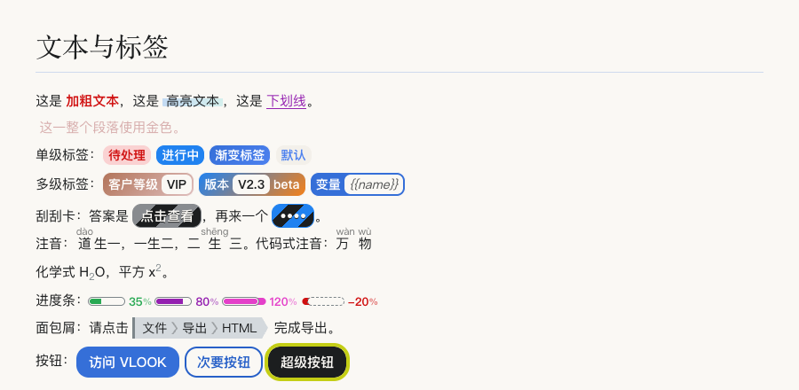
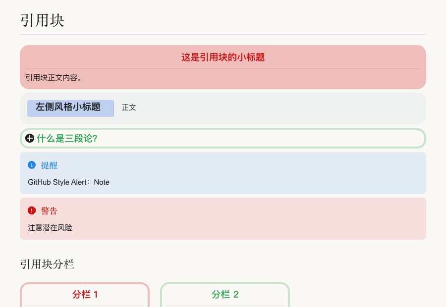
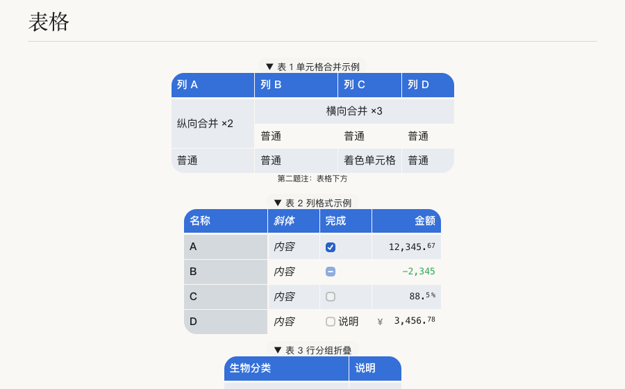
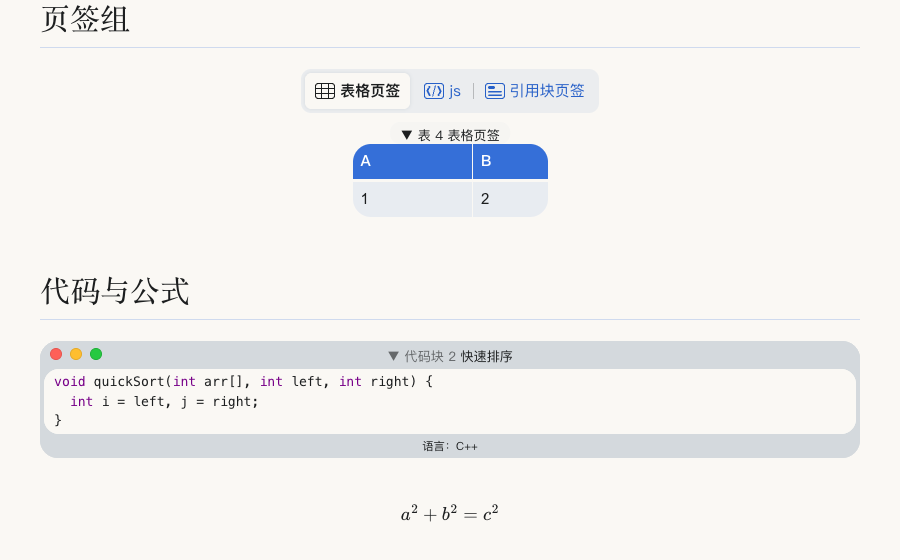
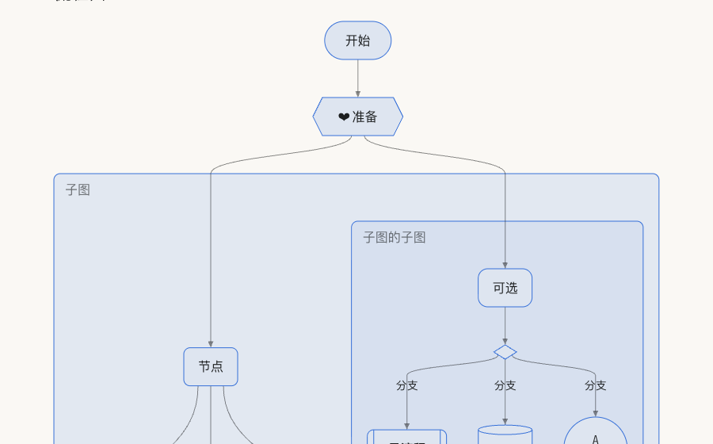
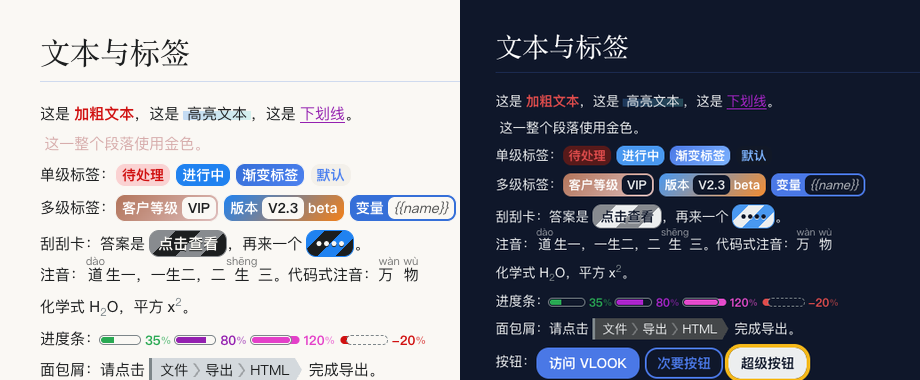
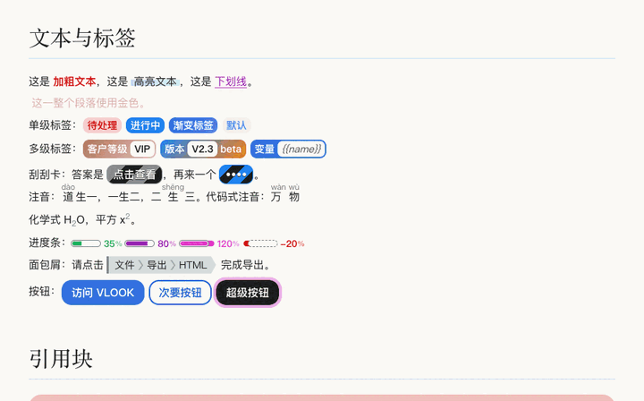
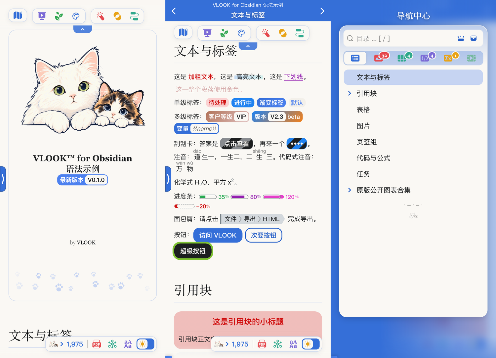
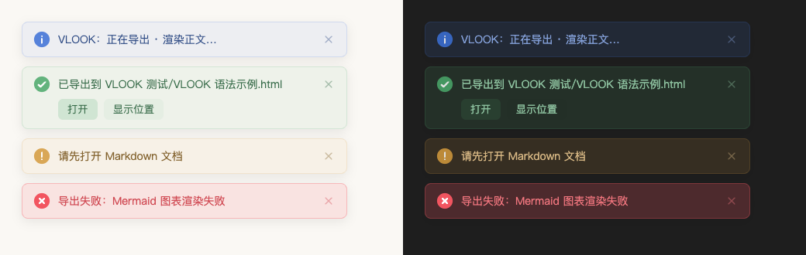

<p align="center"></p>

<p align="center">
  
  
  
  
</p>

<h3 align="center">把笔记排成一本书</h3>

<p align="center">色号着色 · 标签 · 引用块分栏 · 表格合并 · 页签组 · 封面封底 · 图表<br>一键导出单文件 HTML 或 PDF</p>

本插件**参考 [VLOOK for Typora](https://github.com/MadMaxChow/VLOOK) 的功能与语法，在 Obsidian 中重新实现**，并经原作者授权发布。渲染、编辑体验、设置和导出流程都按 Obsidian 的使用习惯重新设计，语法与原版保持一致，为 Typora 写的 VLOOK 文档可以直接拿来用。

## 一眼看懂

<table>
<tr>
<td width="50%" valign="top"><br><b>色号与标签</b><br>一句话着色，单级、多级标签、刮刮卡、注音、进度条</td>
<td width="50%" valign="top"><br><b>引用块与分栏</b><br>小标题、着色、提示块，加几行 <code>---</code> 就能分栏等高</td>
</tr>
<tr>
<td valign="top"><br><b>表格</b><br>单元格合并、列格式、行分组折叠、自动题注编号</td>
<td valign="top"><br><b>页签组、代码与公式</b><br>表格、插图、代码块并成页签，代码带语言与题注</td>
</tr>
<tr>
<td valign="top"><br><b>图表</b><br>流程图、时序图、状态机、类图等，主题配色自动适配</td>
<td valign="top"><br><b>浅色与深色</b><br>跟随系统，切换时渐变过渡，不再生硬闪一下</td>
</tr>
</table>

<p align="center"><br><sub>8 套配色内置于插件，无需另装主题</sub></p>

## 手机上同样好用

导出的 HTML 在手机上功能完整：工具栏可一键收起，目录弹出时自动让位，点击目录条目跳转后自动收起，弹窗不会被系统导航条遮挡。

<p align="center"></p>

## 安装

**社区插件市场**：设置 → 第三方插件 → 浏览，搜索 `VLOOK` 并安装、启用。

**手动安装**：把 `main.js`、`manifest.json`、`styles.css` 以及需要的主题文件（`themes` 文件夹）复制到 `你的库/.obsidian/plugins/vlook/`，重启 Obsidian 后在第三方插件中启用。

启用后即可使用，默认配色是 Ignorance 蓝，随插件内置。

## 快速上手

在笔记里写入下面的内容，切到阅读视图（或实时预览）即可看到效果：

```markdown
这是 **加粗文本**_~Rd~_，这是 ==高亮文本==_~BuAq~_。

*`待处理`*_~Rd~_ *`进行中`*_~Bu!~_ *客户等级`VIP`*_~BnGd~_

**==35==** **==80==**
```

`_~Rd~_` 这类写在文本之后的记号叫**色号**：`Rd` 红、`Bu` 蓝、`Gn` 绿、`Gd` 金……后缀 `!` 表示强调，两个色号连写表示渐变。

### 语法一览

| 类别 | 写法示例 | 说明 |
| ---- | -------- | ---- |
| 色号 | `**文本**_~Rd~_` | 给紧邻的文本或整段着色 |
| 标签 | ``*`待处理`*_~Rd~_`` | 单级标签；``*客户等级`VIP`*`` 为多级标签 |
| 刮刮卡 | `*点击查看**42***` | 点击后显示答案 |
| 注音 | `道_^dào^_`、`` `{万物}(wàn wù)` `` | 上标式与代码式两种 |
| 进度条 | `**==35==**`、`**==?==**` | `?` 统计当前文档任务完成度 |
| 面包屑 / 按钮 | `*==文件 > 导出==*`、`[<kbd>访问</kbd>](url)` | 行内导航与按钮 |
| 引用块 | `> **小标题**` 后接正文，末行 `_~Rd!~_` | 小标题、着色、`> [!NOTE]` 提示块 |
| 引用块分栏 | 在引用块前写 1～4 行 `---` | 2～5 栏等高排列，列表也可分栏 |
| 表格 | `==` 横向合并，`:` 纵向合并 | 列格式、行分组折叠、单元格着色 |
| 题注 | `*==题注==*` 写在表格、代码块、公式前 | 自动编号；图片用第二题注 |
| 图片 | ``、`?darksrc=~` | 尺寸与效果、深色图、高清图 |
| 页签组 | `_^tab^_` 独占一行 | 其后连续的表格、图片、代码合并为页签 |
| 封面封底 | 文档首个 `######` 标题 | 最后一个 `#` 标题作为封底 |
| 不发布 | `## ~~章节标题~~` | 导出时移除，编辑时弱化显示 |
| 图表 | ` ```mermaid ` 代码块 | 流程图、时序图、状态机、类图等 |

更多写法见示例笔记 [docs/sample](docs/sample/VLOOK%20语法示例.md)，复制到库里即可对照查看。

## 三种查看方式

1. **阅读视图**：逐块渲染，跨块的编号、页签、分栏按整篇源码计算。长文档按需渲染，滚动到哪渲染到哪。
2. **实时预览**：行内语法直接渲染，表格、引用块、题注、封面、图片、图表等块级内容以区块预览显示；双击或聚焦后按 Enter 回到源码，分栏里的任务勾选会同步写回。
3. **VLOOK 预览与导出**：命令面板运行「打开 VLOOK 预览（完整交互）」或工具栏的导出，得到带导航中心、大纲、阅读模式的完整页面。

## 导出

右上角「导出」或命令面板：

- **导出为 VLOOK HTML**：单文件，图片内嵌（PNG/JPG 在桌面端转为 WebP 以减小体积），保存到笔记同目录，也可更换位置。
- **导出为 VLOOK HTML（含全部主题）**：页面内可切换 8 套配色。
- **发布为 PDF**：先出现打印选项（封面适配 A4、包括大纲、展开详情等），再用系统打印保存。手机上会改为导出 HTML 后用系统浏览器打印。

导出过程会显示进度，完成后提示可直接「打开」或「显示位置」。导出页宽度自适应，手机与桌面功能一致；系统切换浅色 / 深色时页面渐变过渡。

## 配色与明暗

默认配色 Ignorance 内置，更多配色见下文「更多配色」。从状态栏、命令「切换 VLOOK 主题」或右上角菜单切换；明暗跟随 Obsidian 外观，也可用命令「切换浅色 / 深色模式」。预览与导出默认沿用当前配色，也可在文档 YAML 中用 `vlook-theme` 单独指定。导出 HTML 时默认只含当前配色，可在导出对话框中勾选更多配色，页面内即可切换。

## 更多配色

插件内置 Ignorance 一套配色，可用的配色完全由主题文件夹里的文件决定，新增配色不需要更新插件：

- **在线获取**：设置 → VLOOK → 主题文件夹旁的云下载按钮（或命令「获取更多 VLOOK 主题」），从 GitHub 发布页取得可下载的配色清单；之后在配色列表里选用某套时才下载它的文件。
- **手动安装**：
  1. 到 [GitHub 发布页](https://github.com/ignorance-shiyao/VLOOK-for-Obsidian/releases) 下载配色文件（`theme-配色名.css`），或使用作者单独提供的配色文件。
  2. 打开主题文件夹：设置 → VLOOK → 主题文件夹旁的文件夹按钮，或命令「打开 VLOOK 主题文件夹」。没有这个文件夹时会自动创建；也可以自己在插件目录下新建 `themes`。
  3. 把文件放进去，保存时文件名就是配色的名称（去掉 `theme-` 前缀，如 `hope.css`），回到 Obsidian 即自动识别，随后在配色列表里选用。

主题文件夹在库的配置文件夹内（默认 `.obsidian`，该文件夹默认隐藏）：

| 系统 | 路径 | 显示隐藏文件夹 |
| ---- | ---- | ---- |
| Windows | `你的库\.obsidian\plugins\vlook\themes\` | 资源管理器 → 查看 → 隐藏的项目 |
| macOS | `你的库/.obsidian/plugins/vlook/themes/` | 访达中按 `⌘ ⇧ .` |
| Linux | `你的库/.obsidian/plugins/vlook/themes/` | 文件管理器中按 `Ctrl H` |

手机端无法直接打开该文件夹，请用设置里的「主题目录」指向库内的普通文件夹放置配色文件。

每套配色是 `themes` 文件夹里的一个 CSS 文件，文件名即配色名称，公共样式在 `common.css`；文件开头可选的 `/*@vlook-theme {"name":"显示名称","color":"#色值"}*/` 用来设置列表里的显示名称与色点。要使用自己的或定制的配色，把文件放进设置里的「主题目录」（库内任意文件夹），文件名与内置配色相同时覆盖内置配色；放入或修改后自动生效，也可用命令「重新加载 VLOOK 主题」。

## 设置

| 分组 | 内容 |
| ---- | ---- |
| 样式 | 插件配色、预览 / 导出所用配色、主题目录 |
| 可选功能 | ZenUML 图表、在线字体（默认均关闭） |
| 导出 | PDF 面板配色、加载页样式（跟随主题或经典样式）、是否显示署名及自定义署名 |
| 语法与排版 | 各类语法的开关：上下标、标题编号、题注、页签组、分栏、封面、编辑模式行内渲染 |
| 默认色号 | 引用块、标签、多级标签、刮刮卡未指定色号时使用的颜色 |

## 常用命令

在命令面板输入「VLOOK」即可看到全部命令，常用的有：

- 切换主题、切换浅色 / 深色模式
- 打开 VLOOK 预览、导出为 VLOOK HTML、发布为 PDF
- 导航中心（章节与题注）、文库导航、链接地图、检查库内链接与锚点
- 激光笔、聚光灯、段落漫游、宁静视图、原生幻灯片
- 继续上次阅读、返回上一文内位置

## 提示

插件内的提示按等级使用四种颜色：信息跟随主题色，成功为绿色，警告为橙色，只有错误保持醒目的红色。

<p align="center"></p>

## 隐私与联网

插件不执行动态代码，导出的 HTML 不引用外部脚本或样式。联网只有两种情况：

- **获取配色清单、选用尚未下载的配色**：仅在你点击「获取更多主题」或选用清单中的配色时，从本插件的 GitHub 发布页下载清单或该配色的 CSS 文件，保存到插件目录后不再重复下载，插件升级后才会刷新。内容只有样式，不含脚本，不上传任何数据；下载失败时可手动把配色文件放入 `themes` 文件夹。
- 以下两项需要你在「设置 → 可选功能」中手动开启：

| 选项 | 作用 | 说明 |
| ---- | ---- | ---- |
| ZenUML 图表 | 渲染 `zenuml` 时序图 | 读取插件目录下的 `zenuml.js` 并执行。该文件作为独立附件提供，不在默认安装包内；未开启时 `zenuml` 代码块按源码原样显示 |
| 在线字体 | 为部分主题加载网络字体 | 从 `openfonts.pages.dev` 获取；关闭时使用系统字体，导出页也不再预连接外部域名 |

完整预览窗口加了内容安全策略：只运行页面自身生成的脚本，笔记里的内联事件和 `javascript:` 链接不会执行。

## 已知限制

- Obsidian 本身不识别 `~下标~`、`^上标^`，插件在阅读视图与实时预览中补充渲染（可在设置中关闭）。
- 实时预览里，若行内 HTML 标签内含反引号包裹的标签（如 ``<u>支持 `<kbd>` 标签</u>``），Obsidian 编辑器的解析会在此中断，其后内容显示为源码，阅读视图和导出不受影响；改写为 `<u>支持 &lt;kbd&gt; 标签</u>` 即可。
- 几十万字的超长文档在实时预览中编辑时可能有轻微延迟，可关闭「编辑模式渲染行内语法」。
- 手机不支持直接生成 PDF 文件，请用导出 HTML 后系统打印。

## 开发

构建、测试与目录结构见 [DEVELOPMENT.md](DEVELOPMENT.md)。

## 致谢与许可

语法与整体设计参考 [MadMaxChow/VLOOK](https://github.com/MadMaxChow/VLOOK)（VLOOK for Typora），感谢原作者 Max Chow 的授权与支持。本插件以 MIT 协议发布，见 [LICENSE](LICENSE)。"VLOOK" 名称与相关标识归原作者所有。

---

## English summary

**VLOOK for Obsidian** brings rich typesetting to Obsidian notes: colour marks, tags, quote columns, merged table cells, tab groups, covers and diagrams, with one-click export to a self-contained HTML file or PDF. It is a re-implementation for Obsidian, inspired by [VLOOK for Typora](https://github.com/MadMaxChow/VLOOK) and published with the original author's permission; the syntax stays compatible so existing VLOOK documents work as-is.

Eight built-in colour themes with smooth light/dark transitions, mobile-friendly exports, and no network access or dynamic code by default (ZenUML and online fonts are opt-in under Settings → Optional features). Install from Community plugins. The default theme is bundled; other themes are downloaded from this repository's release page the first time you pick them, or can be dropped into the plugin's theme folder by hand.
