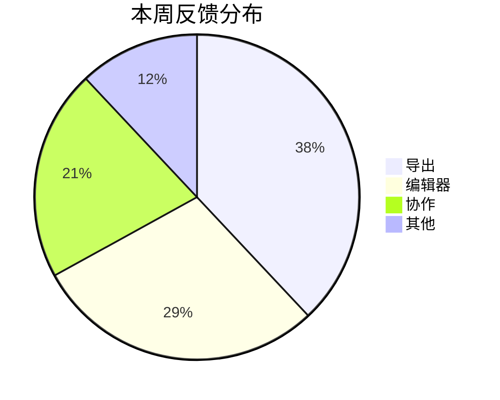

###### 产品周报<br>2026 年第 44 周<br>*当前版本`V2.3`*<br>**产品团队**

# 本周概览

这周交付了 **新版编辑器**_~Rd~_，==性能提升明显==，用户反馈集中在 <u>导出体验</u> 上。

状态：*`已上线`*_~Gn~_ *`灰度中`*_~Bu~_ *`待评审`*_~Og~_ *`已延期`*_~Rd~_

负责人：*客户等级`VIP`*_~BnGd~_ *发布`V2.3`beta*_~BuOg~_ *渠道`Stable`*_~GnTu~_

整体进度：**==82==**　　编辑器：**==100==**　　导出：**==64==**　　协作：**==35==**

按钮：[<kbd>查看完整报告</kbd>](https://github.com/ignorance-shiyao/VLOOK-for-Obsidian) *[<kbd>下载 PDF</kbd>](https://github.com)*

# 关键决策

> **为什么选择先做导出？**
>
> 导出是用户分享成果的最后一步，体验不完整会直接影响口碑。
>
> _~Bu~_

> [!TIP]
> 导出的单文件 HTML 可直接在手机上打开，随主题自动切换明暗。

---

> **体验**
>
> 阅读与编辑保持一致的行距与排版。
>
> _~Gn~_

> **性能**
>
> 长文档渲染延迟控制在 0.2 秒内。
>
> _~Bu~_

> **兼容**
>
> 桌面与手机，浅色与深色。
>
> _~Pu~_

---

# 数据看板

*==渠道转化_数据来自内部看板_==*

| 渠道 | 访问 | 注册 | 转化率 |
| ---- | ---: | ---: | -----: |
| 自然流量 | 12,480 | 1,126 | 9.0% |
| 社区推荐 | 8,320 | 1,052 | 12.6% |
| 合作渠道 | 3,960 | 358 | 9.0% |
| : | 2,310 | 282 | 12.2% |



# 里程碑

_^tab^_

*==发布计划==*

| 阶段 | 日期 | 状态 |
| ---- | ---- | :--: |
| 内测 | 11-04 | Y |
| 公测 | 11-12 | ? |
| 正式发布 | 11-25 |  |

```js
// 发布脚本
release({ version: "2.3.0", channel: "stable" });
```

> **风险**
>
> 协作模块尚未通过压测。

*==待办==*

- [x] 完成新版编辑器
- [x] 导出支持单文件 HTML
- [ ] 协作模块压测
- [ ] 正式发布
