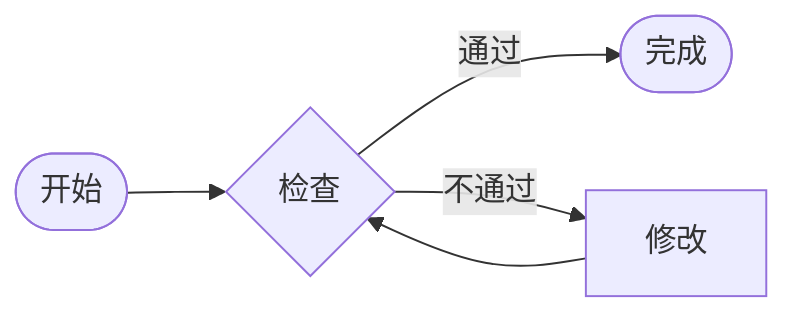
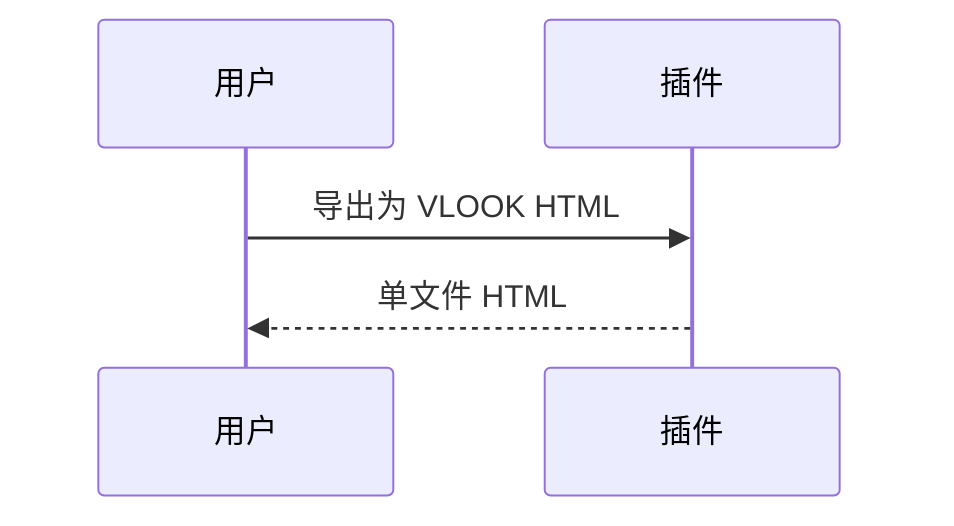

###### VLOOK™ for Obsidian<br>语法示例<br>*最新版本`V0.1.0`*<br>**VLOOK**

# 文本与标签

这是 **加粗文本**_~Rd~_，这是 ==高亮文本==_~BuAq~_，这是 <u>下划线</u>_~Pu~_。

_~Gd~_ 这一整个段落使用金色。

单级标签：*`待处理`*_~Rd~_ *`进行中`*_~Bu!~_ *`渐变标签`*_~T1T2~_ *`默认`*

多级标签：*客户等级`VIP`*_~BnGd~_ *版本`V2.3`beta*_~BuOg~_ *变量`{{name}}`*

刮刮卡：答案是 *点击查看**42***，再来一个 ***默认提示***_~Bu~_。

注音：道_^dào^_生一，一生二，二生_^shēng^_三。代码式注音：`{万物}(wàn wù)`

化学式 H~2~O，平方 x^2^。

进度条：**==35==** **==80==** **==120==** **==-20==**

面包屑：请点击 *==文件 > 导出 > HTML==* 完成导出。

按钮：[<kbd>访问 VLOOK for Obsidian</kbd>](https://github.com/ignorance-shiyao/VLOOK-for-Obsidian) *[<kbd>次要按钮</kbd>](https://github.com)* **[<kbd>超级按钮</kbd>](https://github.com)**

# 引用块

> **这是引用块的小标题**
>
> 引用块正文内容。
>
> _~Rd!~_

> ==左侧风格小标题==
>
> 正文

> ###### 什么是三段论？
>
> 三段论推理是演绎推理中的一种简单推理判断。
>
> _~Gn~_

> [!NOTE]
> GitHub Style Alert：Note

> [!WARNING]
> 注意潜在风险

## 引用块分栏

---
---

> **分栏 1**
>
> 第一栏内容
>
> _~Rd~_

> **分栏 2**
>
> 第二栏内容更长一些，测试等高处理。第二栏内容更长一些，测试等高处理。
>
> _~Gn~_

> **分栏 3**
>
> 第三栏
>
> _~Bu!~_

## 列表分栏

---

- 列表 1
  - 列表项 1-1
- 列表 2
  - 列表项 2-1
- 列表 3
- 列表 4

# 表格

*==单元格合并示例_第二题注：表格下方_==*

| 列 A | 列 B | 列 C | 列 D |
| ---- | ---- | ---- | ---- |
| 纵向合并 ×2 | 横向合并 ×3 | == | == |
| : | 普通 | 普通 | 普通 |
| 普通 | 普通 | 着色单元格_~Rd!~_ | 普通 |

*==列格式示例==*

| **名称** | *斜体* | []完成 | 金额 | ~~不发布~~ |
| -------- | ------ | ------ | ---: | ---------- |
| A | 内容 | Y | 12345.67 | x |
| B | 内容 | ? | -2345 | x |
| C | 内容 |  | 88.5% | x |
| D | 内容 | N 说明 | ¥ 3456.78 | x |

*==行分组折叠==*

| 生物分类 | 说明 |
| -------- | ---- |
| 动物 | |
| > 脊椎动物 | |
| >> 哺乳动物 | 人类 |
| >> 鸟类 | 鸡 |
| > 无脊椎动物 | |
| 植物 | |
| > 被子植物 | 番茄 |

# 页签组

_^tab^_

*==表格页签==*

| A | B |
| - | - |
| 1 | 2 |

```js
// 代码页签
console.log("Hello VLOOK");
```

> **引用块页签**
>
> 引用块内容

# 代码与公式

*==快速排序_语言：C++_==*

```cpp
void quickSort(int arr[], int left, int right) {
  int i = left, j = right;
}
```

*==勾股定理==*

$$
a^2 + b^2 = c^2
$$

# 任务

任务整体进度：**==?==**

- [x] 调查目标客户
- [x] 研究竞争对手
- [ ] 收集市场数据
- [ ] 分析市场趋势

## ~~这一章不发布~~

导出 HTML 时会被移除，编辑时弱化显示。

# 图表

## 流程图



## 时序图


