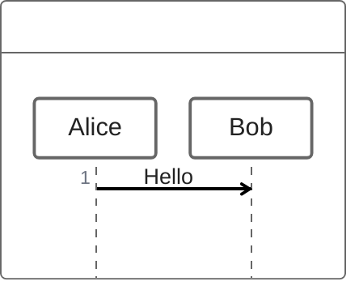

首段保留回归：这段文字必须出现在预览和导出的 HTML 中。

# 编辑与导出回归

[TOC]

## 任务进度

任务进度：**==?==**

- [x] 已完成
- [ ] 待完成

## 页签与题注

_^tab^_

*==表格页签==*

| **列 A** | 列 B |
| --- | --- |
| 合并 | == |

*==代码页签==*

```js
console.log("VLOOK");
```

## 分栏任务

---

> **第一栏**
>
> - [ ] 分栏任务甲

> **第二栏**
>
> - [x] 分栏任务乙

## 公式

*==公式题注==*

$$
a^2 + b^2 = c^2
$$

## 链接与按钮

[回到任务](#任务进度) · [失效锚点](#不存在的章节)

按钮：[<kbd>VLOOK</kbd>](https://github.com/MadMaxChow/VLOOK)

面包屑：*==文件 > 导出 > HTML==*。


## 引用代码围栏后的真实图片

> ```markdown
> 
> ```

下面的图片必须保留，不能被前面的代码围栏吞掉；阅读、完整预览和导出均应能显示。


## 不同目录同名资源

两张图片分别使用200px和400px宽度，题注不得互换。


行内代码 `` 不应生成图片，也不应占用题注序号。


## Obsidian 1.15 图表兼容

ZenUML 与原生流程图应同时显示，插件可以正常加载。




### 脚注中的图表和公式

下方脚注中的 ZenUML 与公式应完整显示；完整预览、HTML 导出及幻灯片脚注页也应保留。此处为待人工验收案例。[^vlook-nested-diagram]

[^vlook-nested-diagram]: 嵌套渲染回归。

    

    [脚注内的跨文档链接](VLOOK%20语法示例.md)

    <span id="vlook-footnote-anchor">脚注内 HTML 锚点</span>

    脚注内块锚点。 ^vlook-footnote-block

    ```mermaid
    zenuml
    Alice -> Bob: Footnote
    ```

    ```math
    E=mc^2
    ```


# PDF 跨页回归

## 长代码

```python
def pipeline():
    step01 = compute(step00, factor=1)  # 第 01 行
    step02 = compute(step01, factor=2)  # 第 02 行
    step03 = compute(step02, factor=3)  # 第 03 行
    step04 = compute(step03, factor=4)  # 第 04 行
    step05 = compute(step04, factor=5)  # 第 05 行
    step06 = compute(step05, factor=6)  # 第 06 行
    step07 = compute(step06, factor=7)  # 第 07 行
    step08 = compute(step07, factor=8)  # 第 08 行
    step09 = compute(step08, factor=9)  # 第 09 行
    step10 = compute(step09, factor=10)  # 第 10 行
    step11 = compute(step10, factor=11)  # 第 11 行
    step12 = compute(step11, factor=12)  # 第 12 行
    step13 = compute(step12, factor=13)  # 第 13 行
    step14 = compute(step13, factor=14)  # 第 14 行
    step15 = compute(step14, factor=15)  # 第 15 行
    step16 = compute(step15, factor=16)  # 第 16 行
    step17 = compute(step16, factor=17)  # 第 17 行
    step18 = compute(step17, factor=18)  # 第 18 行
    step19 = compute(step18, factor=19)  # 第 19 行
    step20 = compute(step19, factor=20)  # 第 20 行
    step21 = compute(step20, factor=21)  # 第 21 行
    step22 = compute(step21, factor=22)  # 第 22 行
    step23 = compute(step22, factor=23)  # 第 23 行
    step24 = compute(step23, factor=24)  # 第 24 行
    step25 = compute(step24, factor=25)  # 第 25 行
    step26 = compute(step25, factor=26)  # 第 26 行
    step27 = compute(step26, factor=27)  # 第 27 行
    step28 = compute(step27, factor=28)  # 第 28 行
    step29 = compute(step28, factor=29)  # 第 29 行
    step30 = compute(step29, factor=30)  # 第 30 行
    step31 = compute(step30, factor=31)  # 第 31 行
    step32 = compute(step31, factor=32)  # 第 32 行
    step33 = compute(step32, factor=33)  # 第 33 行
    step34 = compute(step33, factor=34)  # 第 34 行
    step35 = compute(step34, factor=35)  # 第 35 行
    step36 = compute(step35, factor=36)  # 第 36 行
    step37 = compute(step36, factor=37)  # 第 37 行
    step38 = compute(step37, factor=38)  # 第 38 行
    step39 = compute(step38, factor=39)  # 第 39 行
    step40 = compute(step39, factor=40)  # 第 40 行
    step41 = compute(step40, factor=41)  # 第 41 行
    step42 = compute(step41, factor=42)  # 第 42 行
    step43 = compute(step42, factor=43)  # 第 43 行
    step44 = compute(step43, factor=44)  # 第 44 行
    step45 = compute(step44, factor=45)  # 第 45 行
    step46 = compute(step45, factor=46)  # 第 46 行
    step47 = compute(step46, factor=47)  # 第 47 行
    step48 = compute(step47, factor=48)  # 第 48 行
    step49 = compute(step48, factor=49)  # 第 49 行
    step50 = compute(step49, factor=50)  # 第 50 行
    step51 = compute(step50, factor=51)  # 第 51 行
    step52 = compute(step51, factor=52)  # 第 52 行
    step53 = compute(step52, factor=53)  # 第 53 行
    step54 = compute(step53, factor=54)  # 第 54 行
    step55 = compute(step54, factor=55)  # 第 55 行
    step56 = compute(step55, factor=56)  # 第 56 行
    step57 = compute(step56, factor=57)  # 第 57 行
    step58 = compute(step57, factor=58)  # 第 58 行
    step59 = compute(step58, factor=59)  # 第 59 行
    step60 = compute(step59, factor=60)  # 第 60 行
    step61 = compute(step60, factor=61)  # 第 61 行
    step62 = compute(step61, factor=62)  # 第 62 行
    step63 = compute(step62, factor=63)  # 第 63 行
    step64 = compute(step63, factor=64)  # 第 64 行
    step65 = compute(step64, factor=65)  # 第 65 行
    step66 = compute(step65, factor=66)  # 第 66 行
    step67 = compute(step66, factor=67)  # 第 67 行
    step68 = compute(step67, factor=68)  # 第 68 行
    step69 = compute(step68, factor=69)  # 第 69 行
    step70 = compute(step69, factor=70)  # 第 70 行
    step71 = compute(step70, factor=71)  # 第 71 行
    step72 = compute(step71, factor=72)  # 第 72 行
    step73 = compute(step72, factor=73)  # 第 73 行
    step74 = compute(step73, factor=74)  # 第 74 行
    step75 = compute(step74, factor=75)  # 第 75 行
    step76 = compute(step75, factor=76)  # 第 76 行
    step77 = compute(step76, factor=77)  # 第 77 行
    step78 = compute(step77, factor=78)  # 第 78 行
    step79 = compute(step78, factor=79)  # 第 79 行
    step80 = compute(step79, factor=80)  # 第 80 行
    step81 = compute(step80, factor=81)  # 第 81 行
    step82 = compute(step81, factor=82)  # 第 82 行
    step83 = compute(step82, factor=83)  # 第 83 行
    step84 = compute(step83, factor=84)  # 第 84 行
    step85 = compute(step84, factor=85)  # 第 85 行
    step86 = compute(step85, factor=86)  # 第 86 行
    step87 = compute(step86, factor=87)  # 第 87 行
    step88 = compute(step87, factor=88)  # 第 88 行
    step89 = compute(step88, factor=89)  # 第 89 行
    step90 = compute(step89, factor=90)  # 第 90 行
    very_long_line = "跨页长行检查跨页长行检查跨页长行检查跨页长行检查跨页长行检查跨页长行检查跨页长行检查跨页长行检查跨页长行检查跨页长行检查跨页长行检查跨页长行检查跨页长行检查跨页长行检查跨页长行检查跨页长行检查跨页长行检查跨页长行检查跨页长行检查跨页长行检查跨页长行检查跨页长行检查跨页长行检查跨页长行检查跨页长行检查跨页长行检查跨页长行检查跨页长行检查跨页长行检查跨页长行检查跨页长行检查跨页长行检查跨页长行检查跨页长行检查跨页长行检查跨页长行检查跨页长行检查跨页长行检查跨页长行检查跨页长行检查末尾标记LONGLINEEND"
    return "CODEEND"
```

## 长表格

| 序号 | 数值 | 结尾 |
| --- | --- | --- |
| 行01 | 数据 7 | ROW01END |
| 行02 | 数据 14 | ROW02END |
| 行03 | 数据 21 | ROW03END |
| 行04 | 数据 28 | ROW04END |
| 行05 | 数据 35 | ROW05END |
| 行06 | 数据 42 | ROW06END |
| 行07 | 数据 49 | ROW07END |
| 行08 | 数据 56 | ROW08END |
| 行09 | 数据 63 | ROW09END |
| 行10 | 数据 70 | ROW10END |
| 行11 | 数据 77 | ROW11END |
| 行12 | 数据 84 | ROW12END |
| 行13 | 数据 91 | ROW13END |
| 行14 | 数据 98 | ROW14END |
| 行15 | 数据 105 | ROW15END |
| 行16 | 数据 112 | ROW16END |
| 行17 | 数据 119 | ROW17END |
| 行18 | 数据 126 | ROW18END |
| 行19 | 数据 133 | ROW19END |
| 行20 | 数据 140 | ROW20END |
| 行21 | 数据 147 | ROW21END |
| 行22 | 数据 154 | ROW22END |
| 行23 | 数据 161 | ROW23END |
| 行24 | 数据 168 | ROW24END |
| 行25 | 数据 175 | ROW25END |
| 行26 | 数据 182 | ROW26END |
| 行27 | 数据 189 | ROW27END |
| 行28 | 数据 196 | ROW28END |
| 行29 | 数据 203 | ROW29END |
| 行30 | 数据 210 | ROW30END |
| 行31 | 数据 217 | ROW31END |
| 行32 | 数据 224 | ROW32END |
| 行33 | 数据 231 | ROW33END |
| 行34 | 数据 238 | ROW34END |
| 行35 | 数据 245 | ROW35END |
| 行36 | 数据 252 | ROW36END |
| 行37 | 数据 259 | ROW37END |
| 行38 | 数据 266 | ROW38END |
| 行39 | 数据 273 | ROW39END |
| 行40 | 数据 280 | ROW40END |
| 行41 | 数据 287 | ROW41END |
| 行42 | 数据 294 | ROW42END |
| 行43 | 数据 301 | ROW43END |
| 行44 | 数据 308 | ROW44END |
| 行45 | 数据 315 | ROW45END |
| 行46 | 数据 322 | ROW46END |
| 行47 | 数据 329 | ROW47END |
| 行48 | 数据 336 | ROW48END |
| 行49 | 数据 343 | ROW49END |
| 行50 | 数据 350 | ROW50END |
| 行51 | 数据 357 | ROW51END |
| 行52 | 数据 364 | ROW52END |
| 行53 | 数据 371 | ROW53END |
| 行54 | 数据 378 | ROW54END |
| 行55 | 数据 385 | ROW55END |
| 行56 | 数据 392 | ROW56END |
| 行57 | 数据 399 | ROW57END |
| 行58 | 数据 406 | ROW58END |
| 行59 | 数据 413 | ROW59END |
| 行60 | 数据 420 | ROW60END |
| 行61 | 数据 427 | ROW61END |
| 行62 | 数据 434 | ROW62END |
| 行63 | 数据 441 | ROW63END |
| 行64 | 数据 448 | ROW64END |
| 行65 | 数据 455 | ROW65END |
| 行66 | 数据 462 | ROW66END |
| 行67 | 数据 469 | ROW67END |
| 行68 | 数据 476 | ROW68END |
| 行69 | 数据 483 | ROW69END |
| 行70 | 数据 490 | ROW70END |

段内文字：表格之后的公开段落 PUBLICAFTERTABLE。

## ~~内部章节 SECRETCHAPTER~~

这段不应出现在 PDF：SECRETBODY。

## 公开末章

公开末章正文 PUBLICTAIL。
